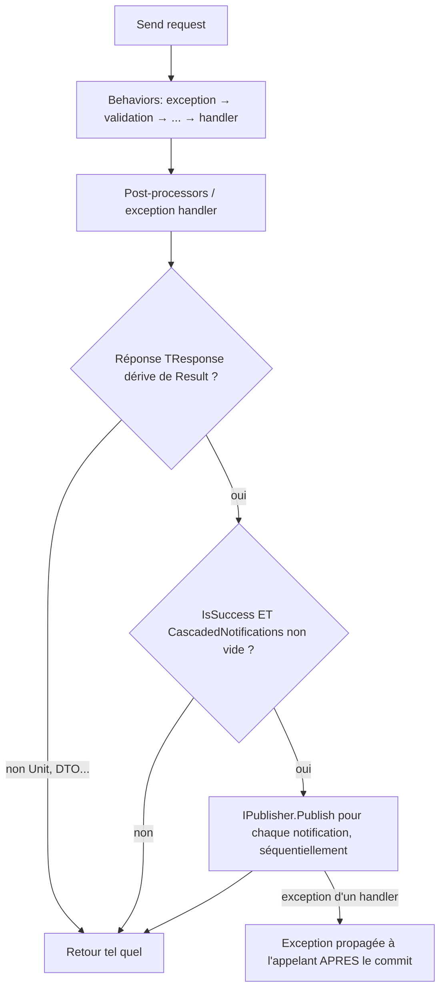

# Diagnostic fonctionnel — Mediarq

> Convention : **[F]** = fait vérifié dans le dépôt (avec `fichier:ligne`). **[H]** = hypothèse, non vérifiée par exécution.
> Aucun code n'a été compilé ni exécuté ; tout est issu de la lecture du code, des docs et des tests. Branche : `fix/nuget-meta-package-no-framework-assets` (HEAD `7ca85d5`), tags jusqu'à `v1.5.1`.
> Ce document est complémentaire de `cahier des charges/analyse-projet-propositions-2026-10.md` (analyse technique/priorisation, non versionnée) : il n'en reprend pas le backlog, il en confirme certains points quand ils ont une portée fonctionnelle (références `#n`).

## 1. Objet et périmètre

Mediarq est une bibliothèque .NET (net8/9/10) de médiation CQRS : commandes, requêtes, requêtes streaming, notifications, type `Result`, pipeline de behaviors, générateur de source (AOT), analyzers et ~25 packages d'extension (README.md:354-386).

**Périmètre du diagnostic** : (a) cartographier les capacités réellement livrées vs documentées ; (b) expliciter les règles de gestion implicites (cascade `Result.WithNotifications`, dispatch différé) ; (c) relever incohérences/ambiguïtés de spécification ; (d) lister les cas d'usage non couverts.

**Hors périmètre** (voir HANDOFF) : priorisation (product-owner), choix de solution technique (architectes), performance/benchmarks, sécurité détaillée.

**Utilisateurs de la spécification** : les « acteurs » ci-dessous sont des développeurs consommateurs de la bibliothèque, pas des utilisateurs finaux.

## 2. Acteurs

| Acteur | Description | Droits / interactions |
|---|---|---|
| Développeur applicatif | Écrit commandes, requêtes, handlers, validators | Dispatche via `ISender`/`IPublisher`/`IMediator`, attache des notifications au `Result` |
| Intégrateur / DevOps | Câble DI, packages, workers (Hangfire, Quartz, hosted services), brokers | `AddMediarq*`, configuration de stores et transports |
| Mainteneur de la lib | Publie packages, tient CHANGELOG/ROADMAP/docs | Tags `v*`, `release.yml` |
| Migrant MediatR | Développeur venant de MediatR | Guide de migration, analyzer MQ100, `Mediarq.MediatRCompat` |
| Système tiers | Hangfire/Quartz, brokers (RabbitMQ, ASB, Dapr, gRPC, MassTransit), host ASP.NET | Rejouent des commandes/notifications dans le pipeline |

## 3. Cartographie des capacités (livré vs documenté)

Légende : ✅ livré et documenté de façon cohérente · ⚠️ livré, documentation partielle/incohérente · ❌ documenté mais non livré · 🕳️ livré, non documenté dans la source citée.

### 3.1 Cœur (`Mediarq.Core`)

| Capacité | Livré (code) | Documenté (README / guides) | Statut |
|---|---|---|---|
| Commandes/requêtes avec `Result` | `ICommand<T>`, `IQuery<T>` | README.md:134-154, concepts.md | ✅ |
| Commande sans résultat (`Unit`) | `ICommand : ICommandOrQuery<Unit>` (`ICommand.cs`), `Mediator.cs:127-128` | README.md:156-174 | ⚠️ voir RG-VAL-002 (validation/autorisation des commandes void) |
| Notifications (parallèle par défaut, séquentiel, agrégé) | `ParallelNotificationPublisher`, etc. | README.md:176-194 | ⚠️ défaut « parallèle » vs MediatR séquentiel (analyse #8) |
| Notifications polymorphes (opt-in) | `IPolymorphicNotification`, `NotificationHandlerWrapper.cs:96+` | README.md:196-214, CHANGELOG | ✅ |
| Cascade `Result.WithNotifications(...)` | `Result.cs:39-69,205-209`, `PipelineDispatch.cs:157-232` | README.md:216-232, wiring-extensions.md:34-59, troubleshooting.md:102-110, Samples/README.md | ⚠️ absente du CHANGELOG (grep : 0 occurrence) ; plusieurs règles non documentées (RG-CASC-004 à 009) |
| Streaming | `IStreamRequest<T>` | README.md:20 | ✅ (pas de cascade, normal) |
| Pipeline (ordre, conditionnel, opt-in logging/perf/timeout) | `PipelineExecutor`, `IConditionalPipelineBehavior` | README.md:251-305 | ✅ |
| Validation requêtes + notifications | `ValidationBehavior`, `NotificationHandlerWrapper.cs:55-96` | README.md:307-327 | ⚠️ RG-VAL-002 |
| Combinateurs `Result` | `ResultExtensions.cs` | README.md:341-352 | ⚠️ perdent les notifications cascadées (RG-CASC-007) |
| Source generator + AOT (MQ001-MQ007) | `Mediarq.SourceGenerators` | README.md:99-132 | ✅ ; CONTEXT.md ne cite que MQ001/MQ002 |

### 3.2 Extensions (31 projets dans `src/`, dont Analyzers/SourceGenerators)

| Famille | Packages | Statut doc |
|---|---|---|
| Web / validation | AspNetCore (+ `MapMediarq`), FluentValidation, DataAnnotations, Authorization, RateLimiting | ✅ README + wiring-extensions ; `MapMediarq` absent du README racine (présent : wiring-extensions.md:97, `Mediarq.AspNetCore/README.md:30`) |
| Fiabilité | Caching (mémoire + distribué), Idempotency (+EF), Outbox, Saga, UnitOfWork, EntityFrameworkCore, Polly | ✅ mais règles de gestion croisées non spécifiées (§5) |
| Dispatch différé / planifié | **Hangfire**, **Quartz**, **Deferred** | ⚠️ voir §4.2 |
| Transports | MassTransit, Dapr, RabbitMQ, AzureServiceBus, Grpc | ✅ (README + wiring) |
| Observabilité / ops | Diagnostics, OpenTelemetry, HealthChecks, Aspire | ✅ |
| Qualité / migration | Testing (SpyMediator), Analyzers (MQ100, MQ200-MQ202, MQ204), MediatRCompat, Templates | ⚠️ Analyzers/SourceGenerators sans README (`src/Mediarq.Analyzers`, `src/Mediarq.SourceGenerators`) ; MQ202/MQ204 absents du README et de MQ-liste racine |

### 3.3 Couverture du site de documentation (DocFX)

- **[F]** `docs/index.md` ne cite que 14 packages (AspNetCore, Caching, DataAnnotations, Diagnostics, EntityFrameworkCore, FluentValidation, Idempotency, Idempotency.EFCore, MassTransit, MediatRCompat, OpenTelemetry, Outbox, Polly, UnitOfWork) ; `docs/docfx.json:9-19` n'indexe l'API que de 11 csproj (le méta + 10 extensions) : ni `Mediarq.Core` lui-même (**[H]** couvert indirectement via le méta, non vérifié), ni Idempotency, Outbox ni MediatRCompat, pourtant cités dans `docs/index.md`. Les packages Saga, Hangfire, Quartz, Deferred, Dapr, RabbitMQ, AzureServiceBus, Grpc, Authorization, RateLimiting, Testing, HealthChecks, Aspire n'ont pas d'API générée sur le site (ils ont un README de package et une section dans `wiring-extensions.md`).
- `docs/guides/concepts.md` (« les cinq idées ») ne mentionne ni la cascade, ni le dispatch différé, ni les notifications polymorphes.

## 4. Processus et règles de gestion implicites

### 4.1 Cascade de notifications — `Result.WithNotifications(...)`



Source : `PipelineDispatch.cs:165-232` (gate `CascadeSupport<TResponse>.IsResultResponse` ligne 237-239).

**Règles de gestion (explicites = documentées ; implicites = déduites du code)**

| ID | Règle | Type | Source | Documentée ? |
|---|---|---|---|---|
| RG-CASC-001 | Les notifications attachées via `WithNotifications` ne sont publiées que si le `Result` final est un succès. | explicite | `PipelineDispatch.cs:186` | oui (README:229-231) |
| RG-CASC-002 | La publication a lieu après tous les behaviors, exception handler et post-processors. | explicite | `PipelineDispatch.cs:151-154,157-159` | oui |
| RG-CASC-003 | La publication passe par `IPublisher` donc par l'`INotificationPublisher` enregistré (y compris décorateurs Diagnostics/Spy). | explicite | `PipelineDispatch.cs:215-222` ; `ServiceCollectionExtensions.cs:244` | oui (partiellement) ; effet sur `SpyMediator` : **[H]** les cascades sont enregistrées car `IPublisher` résout l'`IMediator` décoré |
| RG-CASC-004 | Les notifications cascadées sont publiées **l'une après l'autre** (boucle `await`), quel que soit l'`INotificationPublisher` : le publisher Parallel ne parallélise qu'à l'intérieur d'**une** notification. La première notification en échec interrompt les suivantes, qui ne sont jamais publiées. | implicite | `PipelineDispatch.cs:228-231` | **non** |
| RG-CASC-005 | Une exception levée par un handler de notification cascadée est propagée à l'appelant de `Send` alors que le handler de commande (et l'éventuel commit `UnitOfWork`) a déjà réussi : l'appelant voit une exception pour une commande dont l'état est persisté. Elle n'est pas convertie en `Result` par `IRequestExceptionHandler` (la cascade s'exécute en dehors du pipeline). | implicite | `PipelineDispatch.cs:151-154,199,209` | **non** |
| RG-CASC-006 | Si `IPublisher` n'est pas résoluble, la cascade est ignorée silencieusement (aucun log). | implicite | `PipelineDispatch.cs:217-226` | non (noté en commentaire de code uniquement) ; test `MediatorTests.cs:310` |
| RG-CASC-007 | Les notifications sont portées par l'instance de `Result`. Tout combinateur qui crée une nouvelle instance (`Map`, `MapAsync`, `Bind`, `Combine`, `Recover`/`OrElse` selon cas) **perd** les notifications ; `Ensure`/`Tap` conservent l'instance. | implicite | `ResultExtensions.cs:14-17,23-26,75-99,130-160` | **non** |
| RG-CASC-008 | Les notifications ne sont pas sérialisées par le convertisseur JSON de `Result` : après un aller-retour JSON (cache distribué, idempotence), la cascade est perdue. | implicite | `ResultJsonConverter.cs` (aucune référence aux notifications) | non |
| RG-CASC-009 | Si la réponse est servie depuis `CachingBehavior` (mémoire), c'est la **même instance** de `Result` qui est restituée, donc les notifications attachées sont **republiées à chaque cache hit**. | implicite **[H]** à valider par test | `CachingBehavior.cs:44-46,57` + `PipelineDispatch.cs:151-154` (cascade après la chaîne de behaviors) | non |
| RG-CASC-010 | Seuls les types de réponse dérivant de `Result` sont inspectés ; `Unit`, DTO bruts, streams : aucune cascade, sans erreur ni diagnostic. | explicite | `PipelineDispatch.cs:237-239` | oui (troubleshooting.md:106-108) |
| RG-CASC-011 | Une cascade n'est pas transactionnelle ni durable : pas d'enfilement vers l'Outbox. | explicite | — | oui (wiring-extensions.md:57-59) |
| RG-CASC-012 | `WithNotifications` sur un échec est sans effet à l'exécution (aucun avertissement). | explicite | `Result.cs:52-53` | oui |

> Tests existants : `MediatorTests.cs:205-315` couvrent RG-CASC-001, 002 (partiel), 006, 012. **[F]** Aucun test ne couvre RG-CASC-004, 005, 007, 008, 009.

### 4.2 Dispatch différé / planifié (Hangfire, Quartz, Deferred)

```mermaid
flowchart LR
  A[Appelant] -->|Enqueue / Schedule / SendLaterAsync| B{Support}
  B -->|Hangfire| C[Job Hangfire sérialisé]
  B -->|Quartz| D[JobDataMap: JSON + AssemblyQualifiedName]
  B -->|Deferred| E[Channel mémoire]
  C --> F[Worker: ISender.Send(command, CancellationToken.None)]
  D --> G[Job: Type.GetType + JsonDeserialize puis Send]
  E --> H[Hosted service: nouveau scope DI puis Send]
  F --> P[Pipeline réel]
  G --> P
  H --> P
  P -->|exception| R[Retry Hangfire / échec Quartz / simple log Deferred]
```

| ID | Règle | Source | Documentée ? |
|---|---|---|---|
| RG-DIF-001 | Seules les commandes **sans résultat** (`ICommand`, réponse `Unit`) sont planifiables ; ni requêtes, ni `ICommand<Result>`, ni `ICommand<Result<T>>` (contrainte `where TCommand : ICommand`). | `HangfireSchedulingExtensions.cs:28,44,60`, `QuartzSchedulingExtensions.cs`, `IDeferredDispatcher.cs` | oui (« no-result form ») |
| RG-DIF-002 | La commande est exécutée par le pipeline réel (behaviors, validation) au moment du job. | `MediarqJobDispatcher.cs:12`, `MediarqQuartzJob.cs:32`, `ChannelDeferredDispatcher.cs:19` | oui |
| RG-DIF-003 | Hangfire et Quartz appellent `Send` avec `CancellationToken.None` (Hangfire) / le token du job (Quartz) : l'annulation d'un job n'est pas propagée uniformément. | `MediarqJobDispatcher.cs:12` vs `MediarqQuartzJob.cs:32` | non |
| RG-DIF-004 | Hangfire : le type concret doit être capturé à l'appel (ne pas passer une variable typée `ICommand`). | README Hangfire | oui |
| RG-DIF-005 | Quartz : la commande est reconstruite par `Type.GetType(AssemblyQualifiedName)` + `System.Text.Json` ; un renommage/déplacement de type rend les jobs persistés non rejouables. | `MediarqQuartzJob.cs:28-30` | partiel (persistance seulement) |
| RG-DIF-006 | Deferred : file en mémoire, aucun délai ni cron ; drain à l'arrêt gracieux ; un échec est loggé puis **ignoré** (pas de retry, pas de dead-letter, pas de signal à l'appelant). | `DeferredDispatchHostedService.cs:23-36` | oui (échec « logged ») ; l'absence de retry n'est pas dite explicitement |
| RG-DIF-007 | Deferred : exécution avec `CancellationToken.None` dans un **nouveau scope DI** : le contexte ambiant de l'appelant (utilisateur HTTP, corrélation) n'est pas transmis. | `DeferredDispatchHostedService.cs:28-30` | non |
| RG-DIF-008 | Une commande différée n'a pas de canal de retour : l'issue (succès/échec) n'est jamais observable par l'appelant. | README Hangfire/Quartz | oui |

**Interactions non spécifiées avec le reste du modèle :**

- **Cascade × différé** : une commande `ICommand` (Unit) ne peut pas cascader (RG-CASC-010) ; or c'est la seule forme planifiable. Un job planifié qui doit émettre un événement doit donc injecter `IPublisher`/`IOutbox`. Aucun guide ne l'indique.
- **Validation × différé** : voir RG-VAL-002 ci-dessous — pour une commande `Unit`, un échec de validation lève `InvalidOperationException` (`ValidationBehavior.cs:153`) ; dans un job Hangfire cela déclenche la politique de retry de Hangfire **[H : retry par défaut de Hangfire, hors dépôt]**, dans Deferred c'est un simple log (RG-DIF-006). Le README Hangfire/Quartz promet « validation » sans préciser ce comportement.
- **Autorisation × différé** : même schéma (`AuthorizationBehavior.cs:93`). Dans un worker il n'y a pas d'utilisateur authentifié : **[H]** une commande `IAuthorizedRequest` planifiée échoue systématiquement.
- **Idempotence × différé** : Hangfire est at-least-once ; l'usage conjoint avec `IIdempotentRequest` n'est pas décrit **[H]**.

### 4.3 Autres règles implicites relevées

| ID | Règle | Source | Documentée ? |
|---|---|---|---|
| RG-VAL-001 | Un échec de validation d'une requête `Result`/`Result<T>` produit un `Result` d'échec de type `Validation` ; un code d'erreur par propriété `Validation.<Request>.<Property>`. | `ValidationBehavior.cs:140-146` | partiel |
| RG-VAL-002 | Pour une réponse qui n'est pas un `Result` (notamment `Unit` des commandes void), un échec de validation **lève** `InvalidOperationException("... not a supported Result type")` au lieu de signaler une erreur de validation exploitable. Même schéma pour `AuthorizationBehavior`. | `ValidationBehavior.cs:153` ; `AuthorizationBehavior.cs:93` ; test `ValidationBehaviorTests.cs:142` | **non** (README:309-310 dit « failed Result / Result<T> » sans mentionner `Unit`) |
| RG-VAL-003 | Une notification invalide lève `NotificationValidationException` (pas de `Result`). | `NotificationHandlerWrapper.cs:93-95` | oui |
| RG-CACHE-001 | Les `Result` en échec sont mis en cache comme les succès (mémoire, distribué) et rejoués pendant la durée du cache ; l'idempotence stocke aussi les échecs. | `CachingBehavior.cs:44-57` ; absence de `IsFailure` dans `Mediarq.Caching`/`Mediarq.Idempotency` | non (analyse #7) |
| RG-PUB-001 | Publier une notification sans handler est un no-op. | `NotificationHandlerWrapper.cs` (`count == 0`) | oui |
| RG-UOW-001 | `UnitOfWorkBehavior` ne commit pas si `Result.IsFailure`. | `UnitOfWorkBehavior.cs:44-46` | oui (troubleshooting.md:183) |

### 4.4 Quatre mécanismes d'« événement après écriture » sans guide de choix

| Mécanisme | Quand publié | Garantie | Où documenté |
|---|---|---|---|
| `IPublisher.Publish` explicite | À l'appel dans le handler | In-process, avant commit éventuel | README |
| Cascade `Result.WithNotifications` | Après pipeline complet, succès seulement | In-process, après commit, exceptions remontent à l'appelant | README, wiring-extensions, Samples |
| Domain events EF (`DomainEventsInterceptor`) | Juste après `SaveChanges` réussi | In-process, lié au commit, indépendant du `Result` | CHANGELOG, Samples/README |
| `IOutbox.Enqueue` | Plus tard, processeur d'arrière-plan | Durable, at-least-once | README, wiring-extensions |

**[F]** Seul `Samples/README.md:36-37` compare partiellement les trois premiers ; aucun guide ne propose de table de décision. Voir §6 (table de décision proposée).

## 5. Incohérences et ambiguïtés de spécification

| # | Constat | Preuve | Gravité |
|---|---|---|---|
| I-01 | **CONTEXT.md périmé** : décrit 9 packages à publier, « 187 tests », « 12 projets de tests », méta-package contenant « toutes les extensions », diagnostics `MQ001`/`MQ002` seulement. Réalité : 31 projets `src/`, 29 projets de tests (`Tests/`), méta-package « lean » (6 extensions : `src/Mediarq/Mediarq.csproj:31-37`), MQ001-MQ007 + MQ100 + MQ200-MQ204. | `CONTEXT.md:18,24,40,108,119,126` | P1 |
| I-02 | **Contradiction sur le contenu du méta-package** : README.md:52-57 (léger) vs CONTEXT.md:18 et CHANGELOG « Notes » (« core + all extensions »). Le csproj donne raison au README. | `CHANGELOG.md:407-408` | P2 |
| I-03 | **ROADMAP périmée** : v1.0 « current » avec « 🔜 publier v1.0.0 » alors que `v1.0.0`…`v1.5.1` sont taguées ; v1.1 « packages non publiés ni documentés » alors qu'ils sont livrés ; aucune section v1.4/v1.5 ; des livraisons récentes sont rangées sous « Backlog / considering ». | `ROADMAP.md:13-30,71` ; `git tag` | P2 |
| I-04 | **CHANGELOG non conforme à Keep a Changelog** : pas d'en-têtes `## [1.x.y]` pour 1.1 à 1.5.1 (seulement des commentaires « tagged 2026-07-24 »), deux blocs `Added` et `Changed` dans `[Unreleased]`, `[1.0.0]` dupliqué en fin de fichier, versions 1.5.0/1.5.1 jamais mentionnées. Impossible de savoir ce que contient chaque release. | `CHANGELOG.md:7,187,231,261,313,474` | P1 |
| I-05 | **`Result.WithNotifications` absent du CHANGELOG** alors que c'est une capacité publique (#220/#221). | grep : 0 occurrence | P1 |
| I-06 | **Documentation de la cascade incomplète** : RG-CASC-004 à 009 non documentées (ordre séquentiel, exceptions après commit, perte via `Map`/`Bind`, cache, JSON). | §4.1 | P1 |
| I-07 | **Promesse « validation » pour les jobs planifiés** non qualifiée pour les commandes `Unit` (RG-VAL-002). | README Hangfire/Quartz vs `ValidationBehavior.cs:153` | P1 |
| I-08 | **Incohérence de contrat Hangfire/Quartz/Deferred** : annulation (`CancellationToken.None` vs token du job), contexte utilisateur (nouveau scope), retries (Hangfire) vs ignoré (Deferred) ; aucune matrice de comparaison côté utilisateur hormis un paragraphe Deferred. | RG-DIF-003/006/007 | P2 |
| I-09 | **Cache mémoire vs cache distribué/idempotence** : comportement différent pour la cascade (même instance vs aller-retour JSON), non spécifié (RG-CASC-008/009). | §4.1 | P1 (si RG-CASC-009 confirmé) |
| I-10 | **Terminologie** : « command with no result » (README), « void » (README, parity), « Unit » (code), « `ICommand` (no-result form) » (Hangfire) ; et `ICommand<Result>` (succès/échec sans valeur) — cas le plus courant en railway-oriented — n'a **aucun terme** dans les docs, alors qu'il n'est pas planifiable (RG-DIF-001). | `concepts.md:10`, README | P2 |
| I-11 | **Statut incertain des diagnostics** : README liste MQ001-MQ007 (générateur) mais pas MQ100/MQ200-MQ202/MQ204 (Analyzers, sans README de package) ; MQ203 et MQ205 évoqués dans l'analyse mais inexistants (`src/Mediarq.Analyzers` : MQ200, 201, 202, 204 seulement). | `grep DiagnosticId` | P3 |
| I-12 | **Site DocFX incomplet** (voir §3.3) : packages sans API générée ni mention dans `docs/index.md` (13 sans mention). | `docs/index.md`, `docs/docfx.json` | P2 |
| I-13 | **Publisher par défaut** : le README (:192) présente « parallèle » comme défaut ; le guide de migration doit signaler la divergence avec MediatR (séquentiel) — les handlers scoped partageant un `DbContext` échouent en parallèle. | analyse #8 ; `mediatr-parity.md:25` marque « ✅ richer set » sans nuance | P2 |
| I-14 | **Nombre de packages dans les docs** : README « bundles … », CONTEXT « 9 packages » (release.yml en packe 31) ; `docs/index.md` 14. Pas de source de vérité unique. | `release.yml:36-66` | P3 |

## 6. Tables de décision

### 6.1 Que se passe-t-il avec une notification attachée à un `Result` ?

| Réponse dérive de `Result` | `IsSuccess` | Exception dans la chaîne | Instance conservée jusqu'à l'appelant | Notifications publiées ? |
|---|---|---|---|---|
| non | — | — | — | non (RG-CASC-010) |
| oui | non | — | — | non (RG-CASC-001) |
| oui | oui | oui (non convertie) | — | non, exception propagée |
| oui | oui | oui, convertie en `Result` d'échec par un exception handler | non | non (troubleshooting.md:104-106) |
| oui | oui | non | non (`Map`/`Bind` dans un behavior/post-processor) | non (RG-CASC-007) |
| oui | oui | non | oui, servie par cache mémoire | **oui, à chaque hit [H]** (RG-CASC-009) |
| oui | oui | non | oui, servie par cache distribué/idempotence | non (RG-CASC-008) |
| oui | oui | non | oui, exécution normale | oui, séquentiellement ; un échec bloque la suite (RG-CASC-004/005) |

### 6.2 Quel mécanisme choisir pour émettre un événement après une commande ? (proposition à valider)

| Doit survivre à un crash | Dépend du commit DB | Commande planifiable (`Unit`) | Mécanisme recommandé |
|---|---|---|---|
| oui | oui | indifférent | `IOutbox.Enqueue` dans la même transaction |
| non | oui | non (réponse `Result`) | `WithNotifications` (cascade) ou domain event EF |
| non | oui | oui (job planifié) | `IPublisher` injecté, ou domain event EF (la cascade ne s'applique pas à `Unit`) |
| non | non | indifférent | `IPublisher.Publish` explicite |

### 6.3 Que devient une commande `Unit` invalide ?

| Contexte | Comportement actuel | Source |
|---|---|---|
| `Send` direct, avec validateur | `InvalidOperationException` (message technique) | `ValidationBehavior.cs:153` |
| Job Hangfire | Exception dans le worker → politique de retry Hangfire **[H]** | `MediarqJobDispatcher.cs:12` |
| Job Quartz | Exception dans `Execute` → échec du job | `MediarqQuartzJob.cs:32` |
| Deferred | Log d'erreur, élément abandonné | `DeferredDispatchHostedService.cs:32-34` |

## 7. Données manipulées (extraits utiles à la spécification)

| Donnée | Format | Obligatoire | Validation | Sensibilité (RGPD) |
|---|---|---|---|---|
| `Result.CascadedNotifications` | `IReadOnlyList<INotification>` en mémoire, non sérialisée | non | `WithNotifications(null)` → `ArgumentNullException` ; tableau vide → no-op (`Result.cs:60-64`) | Dépend du contenu des notifications (peut contenir des données personnelles ; non persistées) |
| Payload de commande Quartz | JSON `System.Text.Json` + `AssemblyQualifiedName` dans `JobDataMap` | oui | Aucune validation avant stockage | **Les données de la commande sont persistées en clair dans le store Quartz** |
| Payload Hangfire | Sérialisation Hangfire des arguments du job | oui | Aucune avant exécution | Idem : persistées dans le store Hangfire |
| File Deferred | Closures en mémoire | oui | — | Perdues au crash ; pas de persistance |
| Entrée de cache (`ICacheableRequest`) | Instance `Result` (mémoire) / JSON (distribué) | non | Clé fournie par la requête | Clé non cloisonnée par utilisateur/tenant dans la même instance (analyse #6 pour l'idempotence) |

## 8. Cas d'erreur et exceptions

| Cas | Comportement actuel | Comportement attendu à spécifier (proposition) | Message utilisateur |
|---|---|---|---|
| Handler de notification cascadée lève après commit | Exception remonte à l'appelant de `Send` (RG-CASC-005) | Décider : propager (actuel), journaliser et ignorer, ou agréger via `AggregateExceptionNotificationPublisher` ; documenter | Aucun message dédié |
| Notification cascadée n°1 échoue | Les suivantes ne sont pas publiées (RG-CASC-004) | Idem ; aligner sur le publisher configuré | — |
| `Map`/`Bind` après `WithNotifications` | Notifications perdues sans signal | Propager les notifications dans les combinateurs, ou documenter/analyzer | — |
| Cache mémoire + cascade | Republication à chaque hit **[H]** | Ne jamais publier pour une réponse servie du cache ; à trancher | — |
| `IPublisher` non enregistré | Cascade ignorée sans log | Au minimum un log `Warning` | — |
| Commande void invalide | `InvalidOperationException` technique | Exception dédiée de validation (symétrique de `NotificationValidationException`) ou erreur typée | « Validation failed but TResponse type 'Unit' is not a supported Result type » (message actuel, peu parlant) |
| Commande `IAuthorizedRequest` void non autorisée | `InvalidOperationException` (`AuthorizationBehavior.cs:93`) | Exception dédiée 401/403 | idem |
| Job Hangfire/Quartz dont le type a été renommé | Échec à la désérialisation (Quartz : `Type.GetType(... throwOnError: true)`) | Documenter la stratégie de versioning des payloads | — |

## 9. Cas d'usage non couverts (constatés, sans présumer d'un arbitrage de priorité)

| # | Cas d'usage | Aujourd'hui | Observation |
|---|---|---|---|
| U-01 | Planifier une commande `ICommand<Result>` / `ICommand<Result<T>>` (forme recommandée par le README) | Impossible (RG-DIF-001) | L'appelant doit créer une commande `Unit` dédiée |
| U-02 | Planifier une notification avec délai (pas seulement `PublishLaterAsync` immédiat) | Hangfire/Quartz : commandes seulement ; Deferred : sans délai | À confirmer s'il s'agit d'un besoin réel |
| U-03 | Planification récurrente (cron) | Absente du wrapper Mediarq ; possible en passant par Hangfire/Quartz natifs | Non documentée comme hors périmètre |
| U-04 | Émettre un événement depuis un job planifié sans injecter `IPublisher` | Cascade inapplicable (`Unit`) | Cf. 4.2 |
| U-05 | Cascade vers l'Outbox (`WithOutboxMessages`) | Explicitement exclue (RG-CASC-011) | Choix assumé mais sans alternative fluide |
| U-06 | Cascade pour les requêtes streaming | Non supportée (aucun `Result`) | Probablement attendu |
| U-07 | Réception dédupliquée côté consommateur (Inbox) pour RabbitMQ/ASB/Dapr/gRPC | Non livré (analyse #19) | Les READMEs précisent l'absence de dédup |
| U-08 | Propagation CorrelationId/UserId/traceparent vers jobs différés et transports | Non livrée (analyse #21 ; RG-DIF-007) | Perte de traçabilité inter-processus |
| U-09 | Observer l'issue d'un job différé (succès/échec, statut) | Aucun retour (RG-DIF-008) | Hangfire/Quartz le permettent nativement, pas via Mediarq |
| U-10 | Annulation d'un job planifié (via un identifiant) | `Enqueue`/`Schedule` Hangfire retournent l'id ; Quartz retourne une date, pas d'identifiant ; Deferred rien | Asymétrie de contrat |
| U-11 | Inbox/Outbox : message empoisonné, multi-instances | Non couverts (analyse #3-#4) | Portée fiabilité |
| U-12 | Multi-tenancy native | Absente (analyse #22) | — |

## 10. Hypothèses

- **H-01** : la republication de la cascade sur cache hit (RG-CASC-009) découle de la lecture croisée de `CachingBehavior.cs` et `PipelineDispatch.cs` ; aucun test ne la confirme. À vérifier par `qa-engineer` avec un test (`ICacheableRequest` + handler retournant `WithNotifications`).
- **H-02** : le comportement de retry Hangfire sur exception (RG-VAL-002 × Hangfire) repose sur le comportement par défaut de Hangfire, hors dépôt.
- **H-03** : `SpyMediator` enregistre les notifications cascadées parce que `IPublisher` est résolu depuis l'`IMediator` décoré (`ServiceCollectionExtensions.cs:244`, `SpyMediatorServiceCollectionExtensions.cs:30`) ; non testé ici.
- **H-04** : une commande `IAuthorizedRequest` planifiée échoue faute d'utilisateur authentifié dans un worker ; le comportement exact dépend du `IUserContext` enregistré (`isHttp` ou non).
- **H-05** : les tags `v1.5.0`/`v1.5.1` correspondent à du contenu actuellement listé sous `[Unreleased]` ; le CHANGELOG ne permet pas de le confirmer.
- **H-06** : le « graphe graphify » est construit sur un commit antérieur (indiqué par l'analyse d'octobre) ; les requêtes `graphify query` ont servi à l'orientation seulement, la vérification a été faite par lecture directe des fichiers.

## 11. Questions ouvertes

| # | Question | Destinataire |
|---|---|---|
| Q1 | La cascade doit-elle (a) rester in-process et propager les exceptions, (b) isoler les échecs de notification après commit, ou (c) offrir les deux via configuration ? | product-owner (arbitrage) + architecte logiciel |
| Q2 | Une réponse servie depuis le cache doit-elle republier la cascade ? (proposition BA : non) | product-owner |
| Q3 | Les combinateurs `Result` doivent-ils propager `CascadedNotifications` ? | architecte logiciel / développeur |
| Q4 | Les commandes void invalides doivent-elles lever une exception typée plutôt qu'`InvalidOperationException` ? Impact breaking change ? | architecte logiciel |
| Q5 | Faut-il autoriser la planification de `ICommand<Result>` (ignorer le résultat) ? | product-owner |
| Q6 | Quelle est la source de vérité pour le nombre/liste de packages et de diagnostics (CONTEXT, README, docs/index) ? | product-owner / documentation (`technical-writer`) |
| Q7 | Le mainteneur confirme-t-il le contenu des releases 1.4.x/1.5.x pour reconstituer le CHANGELOG ? | utilisateur (mainteneur) |

## 12. Synthèse des écarts prioritaires (proposition de classement, la priorisation finale revient au product-owner)

| Priorité | Écart | Réf. |
|---|---|---|
| P1 | Cascade : republication sur cache hit, perte via `Map`/`Bind`, exceptions après commit non documentées | RG-CASC-004/005/007/009, I-06, I-09 |
| P1 | Commandes void : validation/autorisation lèvent `InvalidOperationException` ; impacte Hangfire/Quartz/Deferred | RG-VAL-002, I-07 |
| P1 | CHANGELOG sans structure de versions et sans l'entrée `WithNotifications` | I-04, I-05 |
| P1 | CONTEXT.md contradictoire avec le code (packages, tests, méta-package) | I-01, I-02 |
| P2 | ROADMAP périmée ; DocFX n'indexe que 14 packages ; contrat différé hétérogène (annulation, contexte, retry) | I-03, I-08, I-12 |
| P2 | `ICommand<Result>` non planifiable, sans terminologie | RG-DIF-001, I-10, U-01 |
| P3 | Diagnostics MQ non listés uniformément ; README manquants pour Analyzers/SourceGenerators | I-11 |

## HANDOFF
- **Agent** : business-analyst
- **Statut** : terminé
- **Livrables** :
  - `docs/01-produit/diagnostic-fonctionnel-2026-11-15.md` — diagnostic fonctionnel : cartographie livré/documenté, 26 règles de gestion (RG-CASC, RG-DIF, RG-VAL, RG-CACHE, RG-PUB, RG-UOW), 14 incohérences, tables de décision, 12 cas d'usage non couverts.
- **Décisions prises** : aucune (diagnostic uniquement). Les « comportements attendus » des §6.2 et §8 sont des propositions à arbitrer.
- **Hypothèses** : H-01 à H-06 (voir §10), notamment la republication de la cascade sur cache hit (non testée) et le retry Hangfire (hors dépôt).
- **Questions ouvertes** : Q1-Q7 (§11) — Q1/Q2/Q5/Q6 au `product-owner`, Q3/Q4 aux architectes, Q7 à l'utilisateur.
- **Risques identifiés** : (1) republication d'événements sur cache hit — doublons métier — vérifier par test puis trancher (`qa-engineer`, architecte logiciel) ; (2) commandes void invalides → exception technique, retries en boucle côté Hangfire — exception typée à étudier (architecte logiciel) ; (3) documentation de pilotage obsolète (CONTEXT, ROADMAP, CHANGELOG) — décisions prises sur de fausses bases — mise à jour (`technical-writer`) ; (4) payloads de commandes persistés en clair dans les stores Hangfire/Quartz — revue sécurité/RGPD (`security-architect`).
- **Agent(s) suivant(s) recommandé(s)** : `product-owner` → arbitrer Q1/Q2/Q5 et prioriser le §12 ; `qa-engineer` → écrire les tests de caractérisation manquants (RG-CASC-004/005/007/008/009, RG-VAL-002 × jobs) ; `technical-writer` → reconstruire CHANGELOG/ROADMAP/CONTEXT et ajouter un guide de choix des mécanismes d'événements (§6.2) ; `software-architect` → trancher Q3/Q4.
